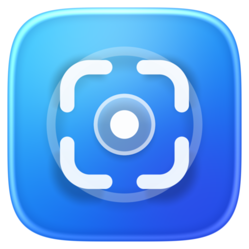
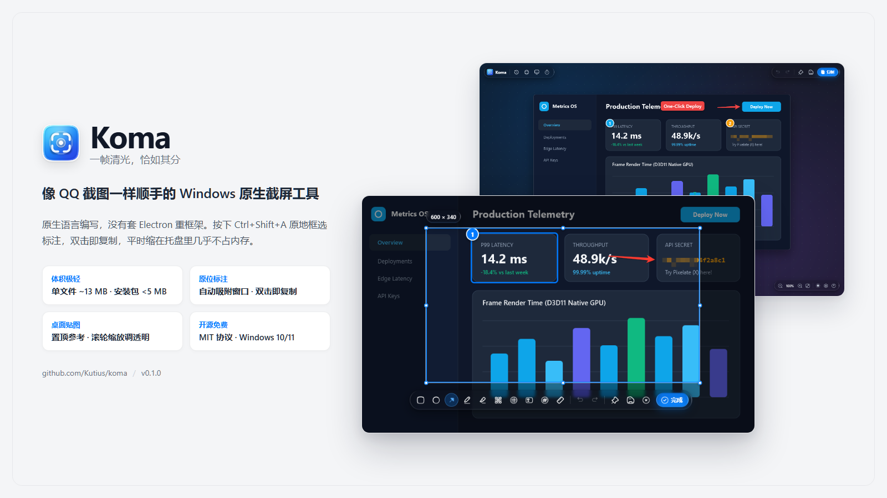
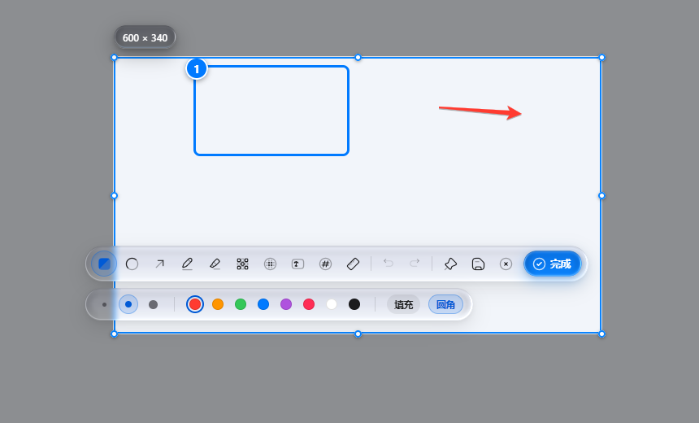
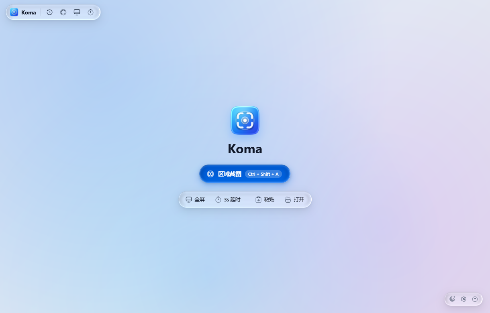

<p align="center">
  
</p>

<h1 align="center">Koma</h1>

<p align="center">
  <strong>一帧清光，恰如其分。</strong><br/>
  <em>Frame the moment, effortlessly.</em>
</p>

<p align="center">
  <a href="https://github.com/Kutius/koma/releases"></a>
  
  
  <a href="LICENSE"></a>
</p>

---

市面上优秀的截图工具已经非常多了。做 **Koma**（源自影像中的「コマ」——一帧、一格）的初衷其实很简单：只是想在 Windows 上复刻一个像 **QQ 截图** 那样顺手、不用切来切去的原位截图工具，同时尽量把它做得**轻量、美观、好看**。

基于纯 Go 与 **MyGo**（Direct3D 11 原生渲染，零 CGO、零 WebView/Electron），体积约 13 MB，常驻托盘低内存占用，把 Apple Liquid Glass 物理光学材质、弹簧微动效与 Solar Duotone 图标语言带到日常截屏里。

<p align="center">
  
</p>

## 预览

| 原位截屏与标注 | 极简主界面 |
| :---: | :---: |
|  |  |

## 特性

- **QQ 截图式原位交互**：按下 `Ctrl+Shift+A` 原地冻结多显示器画面，自动吸附 DWM 窗口轮廓；直接在遮罩上框选、原地文字输入、拖拽微调标注、打码、测距与方向键 1px 调边，双击选区或按 `Enter` 即刻复制并退出，右键重新框选或退出。
- **双引擎离线 OCR 取字**：默认调用经 2× 超分与深色反色增强的 Windows 原生 `Windows.Media.Ocr`（零额外模型），并支持在「设置 → 文字识别」中按需下载纯 Go 本地 **PP-OCRv6** 模型实现中英混排与代码高精度识别，空闲 60 秒自动释放推理内存。
- **滚动长截图**：按下 `Ctrl+Shift+L` 或选区后按 `L` 即刻进入穿透式滚动拼接，支持手动滚轮与一键自动滚动（自动检测到达底部、智能剔除固定顶栏/底栏与滚动条），右侧悬浮液态玻璃实时长图预览，完成后一键复制、编辑、贴图或保存。
- **桌面悬浮贴图（Pin）**：将任意截图或剪贴板图像钉在桌面最顶层，左键自由拖拽、滚轮无级缩放（25%–400%）、`Alt + 滚轮` 调节透明度，右键菜单支持保存、OCR、旋转/翻转与鼠标穿透。
- **物理光学 Liquid Glass**：GPU 着色器实现曲面穹顶折射、边缘色散、定向高光、底部暖色焦散，以及基于背景亮度的自适应对比度。
- **Solar Duotone 状态化图标**：静息为轻盈的 *Line Duotone* 蚀刻线条，激活与按压时平滑过渡为 *Bold Duotone* 饱满双色。
- **极致轻量与低内存**：单文件原生程序，历史记录采用压缩 PNG 存储并在关闭遮罩/贴图时即时释放显存与内存，支持自定义快捷键、默认保存目录与静默快速保存。

## 下载与安装

前往 [Releases](https://github.com/Kutius/koma/releases) 下载：
- `Koma.exe` — 单文件便携版，双击即用
- `koma-setup-<version>-amd64.exe` — Windows 安装程序（支持应用内自动更新）

## 快捷键

| 快捷键 | 功能 |
| :--- | :--- |
| `Ctrl+Shift+A` | 区域截屏（原位标注） |
| `Ctrl+Shift+L` | 滚动长截图 |
| `Ctrl+Shift+S` | 全屏截屏 |
| `Ctrl+Shift+D` | 3 秒延时截屏 |
| `Ctrl+Shift+P` | 贴图剪贴板内容 |
| `双击选区` / `Enter` | 完成并复制到剪贴板 |
| `E` / `L`（选区后） | 转入工作台编辑 / 进入滚动长截图 |
| `↑ ↓ ← →` / `Shift+方向键` | 选区或标注 1px 微调 / 调边 |
| `右键单击` | 重新框选 / 退出截屏 |
| `Space` / `Shift+C` / `M` | 切换窗口吸附 / 切换取色格式与取色 / 像素测距 |
| `R` `O` `A` `P` `H` | 矩形 / 椭圆 / 箭头 / 画笔 / 荧光笔 |
| `X` `B` `S` `T` `N` | 马赛克 / 高斯模糊 / 聚光灯 / 原地文字 / 序号 |

## 开发与构建

环境要求：Go 1.27+（Windows amd64）。

```powershell
# 运行单元测试与界面回归测试
go test -v ./...

# 停止托盘常驻进程并构建 Koma.exe 与安装包
Get-Process -Name Koma -ErrorAction SilentlyContinue | Stop-Process -Force
go tool mygo build
```

构建产物位于 `build/windows-amd64/`：
- `Koma.exe` — 独立便携版
- `koma-setup-<version>-amd64.exe` — Windows 安装程序

## 致谢

- 原生 UI 框架：[MyGo](https://github.com/egoist/mygo)
- 界面图标：[Solar Icons](https://icon-sets.iconify.design/solar/)（CC BY 4.0）
- 光学玻璃着色器与动效灵感：[liquid-glass](https://github.com/bilalgursen/liquid-glass)、[glasswork](https://github.com/kubai087/glasswork)
- 本地高精度 OCR 模型与推理引擎：[RapidOCR](https://github.com/RapidAI/RapidOCR)（PP-OCRv6）、[ONNX Runtime](https://github.com/microsoft/onnxruntime)

## License

[MIT](LICENSE)
